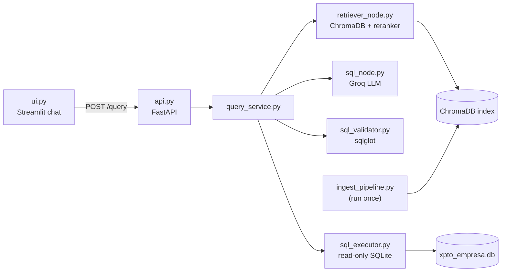

# Ask Your Data

**A text-to-SQL chatbot with RAG. Ask questions about a company database in English or Portuguese and get the SQL, a table, and a chart.**

[](https://github.com/prachichoudhary2004/Ask-Your-Data/actions/workflows/ci.yml)


## How it works



1. **Retrieve.** The question is embedded with a multilingual sentence-transformers model. ChromaDB returns 15 candidate documents (schema notes, column descriptions, examples, rows), and a cross-encoder reranks them down to 5.
2. **Generate.** The LLM (Groq) gets the retrieved context, the **full list of allowed tables and columns**, and the question, and writes one `SELECT` statement.
3. **Validate.** `sqlglot` parses the SQL. Only a single `SELECT` on approved tables passes.
4. **Execute.** The query runs on a read-only SQLite connection with a row limit.
5. **Retry.** If validation or execution fails, the error and the schema go back to the LLM for a corrected query (up to 2 retries).
6. **Show.** The UI displays the table, an automatic bar or line chart when the data fits, the SQL, and the timing.


---


## Quick start

**Requirements:** Python 3.13, [uv](https://docs.astral.sh/uv/), and a [Groq API key](https://console.groq.com/).

```bash
git clone https://github.com/prachichoudhary2004/Ask-Your-Data.git
cd Ask-Your-Data

uv sync                                       # 1. install dependencies
cp .env-example .env                          # 2. then put your key in LLM_API_KEY
uv run python scripts/create_xpto_db.py       # 3. create data/xpto_empresa.db
uv run python ingest_pipeline.py              # 4. build the vector index (a few minutes)
uv run python api.py                          # 5. start the API (terminal 1)
uv run streamlit run ui.py                    # 6. start the UI (terminal 2)
```

Open http://localhost:8501. API docs are at http://127.0.0.1:8000/docs.

> The `data/` folder is git-ignored, so steps 3 and 4 are needed on every fresh clone. To rebuild the index, delete `data/vector_store` first.

**Configuration** (`.env`, see `.env-example`; never commit this file)

| Variable | Meaning |
|---|---|
| `DATABASE_PATH` | SQLite file |
| `VECTOR_COLLECTION`, `VECTOR_STORE_DIR` | ChromaDB collection name and folder |
| `TOP_K` | Documents kept after reranking (default 5) |
| `EMBED_MODEL`, `RERANK_MODEL` | Embedding and cross-encoder model names |
| `LLM_MODEL`, `LLM_API_KEY`, `LLM_TEMPERATURE` | Groq model, key, temperature |
| `ANONYMIZED_TELEMETRY` | `False` turns off ChromaDB telemetry |

**Try these questions:** *How many sales were made in 2023? / Show total revenue by month / What are the best-selling products by quantity? / Qual foi o total de vendas em 2023? / Existem clientes sem nenhuma venda registrada?*

---

## Safety design

The app only ever runs `SELECT`. Five layers enforce it:

1. **Keyword blocklist:** `insert`, `update`, `delete`, `drop`, `alter`, `create`, `pragma`, and similar words are rejected.
2. **One statement:** any semicolon is rejected.
3. **Parse and type check:** `sqlglot` must parse the SQL and it must be a `SELECT`.
4. **Table allowlist:** only the business tables are allowed. The metadata tables are excluded.
5. **Read-only connection and row limit:** SQLite opens in `mode=ro`, and `LIMIT 1000` is added when missing.

The validator checks table names, not column names. A wrong column fails when the query runs and goes to the retry loop.

---

## Evaluation

40 questions with reference ("gold") SQL in `eval/questions.json`: 10 in Portuguese, 5 marked tricky. Model: `openai/gpt-oss-120b` on Groq, run 2026-10-29.

| Scoring rule | Score | What must match |
|---|---|---|
| **Relaxed** | **85% (34/40)** | Same number of rows; every column of values appears in the reference. Column names and order are ignored. |
| Original harness | 52.5% (21/40) | Whole rows. Column names ignored. |
| Strict | 22.5% (9/40) | Column names and row values. |

> **Read this with care.** The relaxed rule was written **after** the first results were seen, so it favours the score. All three numbers are shown on purpose. Every question passed on the first attempt, so the retry loop never ran in the benchmark and its benefit is not measured.

**The 6 failures under the relaxed rule**

| # | Question | Why |
|---|---|---|
| 6 | Total sales per employee in 2023 | Inner join returned 2 employees; the reference LEFT JOIN returns all 10 |
| 34 | Total discount given across all sales | Summed `desconto`; the reference uses `valor_bruto - valor_total` |
| 36 | How many suppliers does XPTO have? | Added a `nome LIKE 'XPTO%'` filter that does not belong |
| 40 | Net revenue after discount per sale | Used `valor_bruto - desconto`; the reference uses `valor_bruto - valor_total` |
| 23, 25 | Employees with a supervisor; sales for zip code 014 | Same rows, different columns than the reference |

**Latency:** the evaluation averaged 7.6 s per question, inflated by Groq rate-limit waits. In manual use of the chat UI, answers took about 2 to 3 seconds.

Run it yourself (uses your Groq quota):

```bash
uv run python eval/run_eval.py --sleep 3
uv run python eval/regrade.py        # strict and relaxed scores for the newest results file
```

---

## Tests and CI

22 unit tests cover the validator, the executor, and the chart helper. They use temporary SQLite files and never import the LLM pipeline, so CI needs no database, model, or API key.

```bash
uv run pytest
uv run ruff check .
```

GitHub Actions runs both on every push and pull request to `main`.

---

## Project structure

```
api.py                  FastAPI application
ui.py                   Streamlit chat UI
query_service.py        Retrieve, generate, validate, execute, retry
retriever_node.py       ChromaDB retrieval and reranking
sql_node.py             Prompt building and SQL generation
sql_validator.py        SQL safety checks
sql_executor.py         Read-only SQLite execution
chart_utils.py          Automatic chart choice
ingest_pipeline.py      One-time index build
scripts/create_xpto_db.py   Creates the sample database
eval/                   Questions, harness, regrade script, results
tests/                  Unit tests
docs/                   FLOW.md, DECISIONS.md, RESUME_FACTS.md
.github/workflows/ci.yml    Lint and test on every push
```

---

Built by [Prachi Choudhary](https://github.com/prachichoudhary2004).
