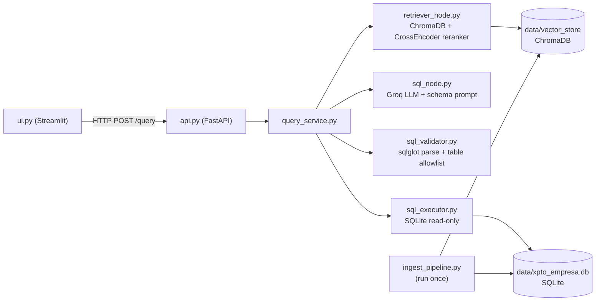

# Ask Your Data — Text-to-SQL Chatbot with RAG

[](https://github.com/prachichoudhary2004/Ask-Your-Data/actions/workflows/ci.yml)

Ask questions about a company database in plain English or Portuguese. The system converts them to SQL using a retrieval-augmented LLM, runs the query, and shows the result as a table and chart.

The database is a fictional Brazilian company called XPTO Empresa. The schema is in Portuguese (`vendas`, `clientes`, `funcionarios`, etc.). The system works with English and Portuguese questions.

---


---

## Features

| Feature | Status |
|---|---|
| Natural-language to SQL (English and Portuguese) | **WORKING** |
| Schema-aware prompt (LLM sees all tables and columns) | **WORKING** |
| RAG retrieval from ChromaDB + cross-encoder reranking | **WORKING** |
| SQL validation (SELECT-only, allowed tables) | **WORKING** |
| Retry loop (up to 2 retries on validation/execution failure) | **WORKING** |
| Automatic bar/line chart based on result shape | **WORKING** |
| Chat history in the UI | **WORKING** |
| Download results as CSV | **WORKING** |
| FastAPI REST endpoint (`/query`) | **WORKING** |
| 22 automated tests + GitHub Actions CI | **WORKING** |
| Retry on LLM API rate-limit (429) | **PARTIAL** — handled in eval harness only, not in the user-facing API |
| CSV / Excel file upload | **NOT BUILT** |
| PDF question input | **NOT BUILT** |
| Docker image | **NOT BUILT** |
| Live demo URL | **NOT BUILT** |
| Token-cost tracking | **NOT BUILT** |
| Follow-up / multi-turn questions | **NOT BUILT** |

---

## Architecture



---

## Tech Stack

| Layer | Technology |
|---|---|
| Language | Python 3.13 |
| Package manager | uv |
| LLM API | Groq (`openai/gpt-oss-120b` at eval time; configurable via `.env`) |
| LLM framework | LangChain + LangChain-Groq |
| Embeddings | `sentence-transformers/paraphrase-multilingual-MiniLM-L12-v2` (local, HuggingFace) |
| Reranker | `cross-encoder/ms-marco-MiniLM-L-6-v2` (local) |
| Vector store | ChromaDB (persisted to disk) |
| Database | SQLite |
| SQL parser / validator | sqlglot |
| API framework | FastAPI + Uvicorn |
| UI | Streamlit |
| Testing | pytest |
| Linter | ruff |

---

## Quick Start

**Requirements:** Python 3.13, [uv](https://docs.astral.sh/uv/), a Groq API key.

```bash
# 1. Install dependencies
uv sync

# 2. Configure environment
cp .env-example .env
# Edit .env and add your Groq API key to LLM_API_KEY

# 3. Create the database  (creates data/xpto_empresa.db)
uv run python scripts/create_xpto_db.py

# 4. Build the vector index  (this takes a few minutes on first run)
uv run python ingest_pipeline.py

# 5. Start the API  (terminal 1)
uv run uvicorn api:app --host 127.0.0.1 --port 8000 --reload

# 6. Start the UI  (terminal 2)
uv run streamlit run ui.py
```

> [!IMPORTANT]
> The `data/` directory is git-ignored. You must run steps 3 and 4 on every fresh clone.

Open [http://localhost:8501](http://localhost:8501) in your browser.

---

## Configuration

All settings are in `.env`. Copy `.env-example` and fill in your values.

| Variable | Description |
|---|---|
| `DATABASE_PATH` | Path to the SQLite database file |
| `VECTOR_COLLECTION` | ChromaDB collection name |
| `VECTOR_STORE_DIR` | Directory where ChromaDB persists its index |
| `TOP_K` | Number of documents to return after reranking (default: 5) |
| `EMBED_MODEL` | HuggingFace embedding model name |
| `RERANK_MODEL` | HuggingFace cross-encoder model name |
| `LLM_MODEL` | Groq model name (e.g. `llama-3.3-70b-versatile`) |
| `LLM_API_KEY` | Your Groq API key |
| `LLM_TEMPERATURE` | LLM temperature (default: 0) |
| `ANONYMIZED_TELEMETRY` | Set to `False` to disable ChromaDB telemetry |

> [!CAUTION]
> Never commit your `.env` file. It is listed in `.gitignore`.

---

## Example Questions

**English:**
- How many sales were made in 2023?
- What are the best-selling products by quantity?
- Show total revenue by month
- List all active employees
- Which employees have a supervisor?
- How many suppliers does XPTO have?

**Portuguese:**
- Quantas vendas foram feitas em 2023?
- Liste os clientes ativos
- Qual é o faturamento por mês?
- Mostre os funcionários por departamento

---

## Safety Design

The system only runs `SELECT` statements. Here is how that is enforced:

1. **Keyword blocklist** — `sql_validator.py` rejects any SQL containing `INSERT`, `UPDATE`, `DELETE`, `DROP`, `ALTER`, `CREATE`, `TRUNCATE`, `PRAGMA`, and others.
2. **Parse and type check** — `sqlglot` parses the SQL. If the parsed statement is not a `SELECT`, it is rejected.
3. **Table allowlist** — only tables that exist in the database are allowed. Metadata tables (`table_comments`, `column_comments`) are excluded from the list.
4. **Read-only connection** — `sql_executor.py` opens SQLite with `?mode=ro`. Even if the validator missed something, the OS-level read-only flag prevents writes.
5. **Row limit** — queries are capped at 1000 rows.

---

## Evaluation

**Benchmark:** 40 questions in `eval/questions.json`. 10 questions are in Portuguese. 5 are marked "tricky". The model tested was `openai/gpt-oss-120b` on Groq, run on 2026-10-29.

**Results** (`eval/results/results-20261029T192658Z.json`, regraded in `eval/results/regrade-20261029T193440Z.json`):

| Metric | Score |
|---|---|
| RELAXED (main number) | **85% (34/40)** |
| STRICT | 22.5% (9/40) |
| Original harness (row values only) | 52.5% (21/40) |

**STRICT** means column names and row values must both match. **RELAXED** means the right values are present, ignoring column aliases and column order.

> [!IMPORTANT]
> The RELAXED rule was designed **after** seeing the original 52.5% result, to give credit for queries that return correct data with different column names. This is a methodological limit: the rule was not pre-specified. The 85% number should be interpreted with that caveat.

**The 6 failures under RELAXED:**

| # | Question | Problem |
|---|---|---|
| 6 | Show total sales per employee in 2023 | Wrong metric (uses `SUM` not `COUNT`) and misses employees with 0 sales |
| 34 | What was the total discount given? | Uses `SUM(desconto)` instead of `SUM(valor_bruto - valor_total)` |
| 36 | How many suppliers does XPTO have? | Filters by `nome LIKE 'XPTO%'` instead of counting all rows |
| 40 | Net revenue after discount for each sale | Returns fewer columns than the gold SQL |
| 23 | Which employees have a supervisor? | Different columns selected |
| 25 | Sales for clients with zip code starting with 014 | Different columns selected |

**The retry loop never ran during the benchmark.** Every question passed validation and execution on the first attempt.

---

## Tests and CI

22 tests across three files:

- `tests/test_validator.py` — `sql_validator.py`
- `tests/test_executor.py` — `sql_executor.py`
- `tests/test_chart_utils.py` — `chart_utils.py`

Tests use temporary SQLite files. They do not import the LLM pipeline, so CI needs no database, model, or API key.

```bash
uv run pytest
uv run ruff check .
```

GitHub Actions runs both on every push and pull request to `main`.

---

## Known Limits

- The few-shot examples in `ingest_pipeline.py` reference tables that do not exist in the XPTO schema (`orders`, `customers`). They may confuse the LLM.
- There are no integration tests for the LLM pipeline.
- Rate-limit (429) backoff is only implemented in the evaluation harness, not in the user-facing API.
- The retry loop has never been exercised in a real benchmark run. Its effectiveness is unknown.
- The database and schema are narrow (one fictional company). Generalisation to other schemas is not measured.

---

## Project Structure

```
.
├── api.py                   # FastAPI application
├── ui.py                    # Streamlit chat UI
├── query_service.py         # Orchestrates retriever → SQL → validate → execute
├── retriever_node.py        # ChromaDB retrieval + cross-encoder reranking
├── sql_node.py              # LLM prompt + SQL generation
├── sql_validator.py         # SQL safety checks
├── sql_executor.py          # Read-only SQLite execution
├── chart_utils.py           # Automatic chart type selection
├── ingest_pipeline.py       # One-time vector store ingestion
├── scripts/
│   └── create_xpto_db.py    # Creates data/xpto_empresa.db
├── eval/
│   ├── questions.json       # 40 benchmark questions
│   ├── run_eval.py          # Evaluation harness
│   ├── regrade.py           # Strict / relaxed re-scoring
│   └── results/             # Benchmark output files
├── tests/                   # Unit tests (no LLM, no DB required)
├── docs/
│   ├── FLOW.md              # Detailed execution flow
│   └── DECISIONS.md         # Architecture decision log
├── .env-example             # Configuration template
├── pyproject.toml           # Dependencies and tool config
└── .github/workflows/ci.yml # GitHub Actions: lint + test
```

---

## Further Reading

- [docs/FLOW.md](docs/FLOW.md) — step-by-step execution trace, call map, state dictionary, error paths
- [docs/DECISIONS.md](docs/DECISIONS.md) — every architecture decision with reasons and trade-offs
