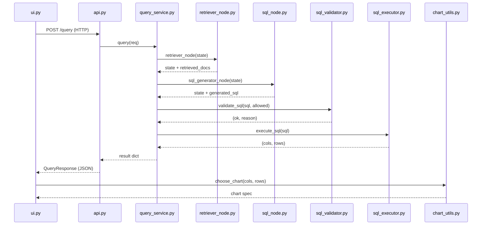

# System Flow

This file was written after the project was built. It describes how the code runs, in the order it runs. All function names are taken directly from the source code.

---

## 1. Entry Points

| Program | File | How to start |
|---|---|---|
| REST API | `api.py` | `uv run uvicorn api:app --host 127.0.0.1 --port 8000 --reload` |
| Chat UI | `ui.py` | `uv run streamlit run ui.py` |
| Database setup | `scripts/create_xpto_db.py` | `uv run python scripts/create_xpto_db.py` |
| Vector store ingestion | `ingest_pipeline.py` | `uv run python ingest_pipeline.py` |
| Evaluation | `eval/run_eval.py` | `uv run python eval/run_eval.py` |
| Re-score existing results | `eval/regrade.py` | `uv run python eval/regrade.py` |

---

## 2. One Question — Start to Finish

The user types a question into the Streamlit chat input. Here is exactly what happens.

1. **User types a question in `ui.py`**
   - Input: plain text in the `st.chat_input` widget.
   - `main()` detects `user_input` or `example_clicked`.
   - The question is appended to `st.session_state.messages`.

2. **`call_api(question)` in `ui.py`**
   - Input: question string.
   - Makes an HTTP POST to `http://127.0.0.1:8000/query` with `{"question": ..., "show_sql": true}`.
   - Output: JSON dict from the API.

3. **`process_query(request)` in `api.py`**
   - Input: `QueryRequest(question=..., show_sql=True)`.
   - Starts a timer with `time.perf_counter()`.
   - Calls `query(service_request)` from `query_service.py`.

4. **`query(req)` in `query_service.py`**
   - Input: `QueryRequest`.
   - Sets `attempts = 0`, `max_attempts = 3`.
   - Builds initial `state = {"question": ..., "messages": []}`.

5. **`retriever_node(state)` in `retriever_node.py`**
   - Input: `state` with `question`.
   - Queries ChromaDB for `TOP_K * 3` (= 15) documents using the embedding of the question.
   - Calls `rerank_documents(question, docs)`, which scores pairs with the CrossEncoder and returns the top `TOP_K` (= 5) docs.
   - Output: `state` with `retrieved_docs` (list of 5 strings).

6. **`sql_generator_node(state)` in `sql_node.py`** (attempt 1)
   - Input: `state` with `question` and `retrieved_docs`.
   - Calls `_allowed_tables_schema()`: connects to SQLite read-only, runs `PRAGMA table_info` and `PRAGMA foreign_key_list` for every business table, returns a formatted multi-line string.
   - Formats `sql_agent_prompt` with context (joined retrieved docs), `allowed_schema`, and `question`.
   - Calls `_get_llm().invoke(prompt_text)` via Groq API.
   - Strips markdown code fences, extracts the `SELECT` statement with a regex.
   - Removes trailing semicolon.
   - Output: `state` with `generated_sql`.

7. **`validate_sql(sql, ALLOWED_TABLES)` in `sql_validator.py`**
   - Input: SQL string, set of allowed table names.
   - Checks: no semicolon, no disallowed keyword, `sqlglot` parse succeeds, statement is `SELECT`, all tables are in the allowed set.
   - Output: `(True, "ok")` or `(False, reason_string)`.
   - If `False`: stores `reason` in `error_msg`, loops back to step 6 (retry via `_llm_retry()`).

8. **`execute_sql(sql)` in `sql_executor.py`**
   - Input: SQL string.
   - Calls `enforce_limit(sql)`: appends `LIMIT 1000` if not present.
   - Opens a read-only SQLite connection.
   - Sets `PRAGMA busy_timeout = 5000` (5 s).
   - Executes the query and calls `fetchmany(1000)`.
   - Output: `(cols, rows)` — list of column names and list of tuples.
   - If exception: stores error in `error_msg`, loops back (retry).

9. **Back in `query()`**
   - Builds `result_rows` as a list of dicts.
   - Returns `{"sql": ..., "cols": ..., "rows": ..., "attempts": ...}`.

10. **Back in `process_query()` in `api.py`**
    - Records latency.
    - Returns `QueryResponse(success=True, sql=..., cols=..., rows=..., latency_seconds=..., attempts=...)`.

11. **Back in `call_api()` in `ui.py`**
    - Receives JSON dict.

12. **`render_answer(result)` in `ui.py`**
    - Displays a `st.dataframe` of the rows.
    - Adds a "Download CSV" button.
    - Calls `choose_chart(cols, rows)` from `chart_utils.py`.
    - If `chart_spec["type"] == "bar"` or `"line"`, renders the chart.
    - Shows the SQL in a collapsible expander.
    - Shows latency and attempt count.

13. **Result stored in `st.session_state.messages`**
    - The assistant message is appended with the full result dict.
    - On the next re-render, the history is replayed from `session_state`.

---

## 3. Call Map

### Mermaid Sequence Diagram



### Call Table

| Caller | Callee | File |
|---|---|---|
| `ui.py::main` | `ui.py::call_api` | `ui.py` |
| `ui.py::call_api` | `api.py::process_query` | HTTP POST |
| `api.py::process_query` | `query_service.py::query` | `query_service.py` |
| `query_service.py::query` | `retriever_node.py::retriever_node` | `retriever_node.py` |
| `retriever_node.py::retriever_node` | `retriever_node.py::rerank_documents` | `retriever_node.py` |
| `query_service.py::query` | `sql_node.py::sql_generator_node` | `sql_node.py` |
| `sql_node.py::sql_generator_node` | `sql_node.py::_allowed_tables_schema` | `sql_node.py` |
| `query_service.py::query` | `sql_validator.py::validate_sql` | `sql_validator.py` |
| `query_service.py::query` | `sql_executor.py::execute_sql` | `sql_executor.py` |
| `sql_executor.py::execute_sql` | `sql_executor.py::enforce_limit` | `sql_executor.py` |
| `sql_executor.py::execute_sql` | `sql_executor.py::open_ro_conn` | `sql_executor.py` |
| `query_service.py::query` | `query_service.py::_llm_retry` | `query_service.py` (retry only) |
| `query_service.py::_llm_retry` | `sql_node.py::_allowed_tables_schema` | `sql_node.py` |
| `ui.py::render_answer` | `chart_utils.py::choose_chart` | `chart_utils.py` |

---

## 4. The State Dictionary

`RAGState` is a `TypedDict` defined in `retriever_node.py`. Each node adds keys:

| Key | Added by | Content |
|---|---|---|
| `question` | Caller (set before `retriever_node`) | The user's question string |
| `messages` | Caller | Empty list `[]` (not currently used beyond initialisation) |
| `retrieved_docs` | `retriever_node` | List of up to 5 document strings from ChromaDB |
| `generated_sql` | `sql_generator_node` or `_llm_retry` | The cleaned SELECT statement string |
| `validated_sql` | Not used in practice | Defined in `RAGState` but never written |
| `sql_result` | Not used in practice | Defined in `RAGState` but never written |

---

## 5. The Retry Path

**When it starts:** after `validate_sql()` returns `False` or `execute_sql()` raises an exception, if `attempts < max_attempts`.

**What runs:**

1. `error_msg` holds the reason string (from the validator) or exception string (from the executor).
2. `prev_sql` = `state["generated_sql"]` (the failed SQL).
3. `_llm_retry(question, prev_sql, error_msg)` is called.
   - Calls `_allowed_tables_schema()` to get the full schema.
   - Builds a prompt: question + failed SQL + error + schema + instruction.
   - Calls Groq API (new `ChatGroq` instance each time).
   - Strips code fences and extracts the SELECT.
   - Returns the corrected SQL string.
4. `state["generated_sql"]` is set to the result.
5. The loop continues: `validate_sql()` is called again on the new SQL.

**Maximum:** 3 total attempts (1 initial + 2 retries).

**In the benchmark:** the retry loop never ran. Every question passed validation and execution on the first attempt.

---

## 6. Error Paths

| Situation | What happens | What the user sees |
|---|---|---|
| `validate_sql()` returns `False` | `error_msg` is set; loop retries up to 2 more times. If still failing after 3 attempts, `query()` raises `ValueError`. | API returns `success=False`. UI shows: *"I couldn't answer that. Try rephrasing your question."* |
| `execute_sql()` raises exception | Same retry behaviour. After 3 failures, `query()` raises `RuntimeError`. | Same as above. |
| LLM API returns an error (e.g. 500) | Exception propagates out of `sql_generator_node` or `_llm_retry`, not caught by the retry loop. `process_query()` in `api.py` catches `ValueError` and `RuntimeError` but not arbitrary exceptions from the LLM. | Depends: if the exception is a `ValueError`/`RuntimeError`/`ConnectionError`/`KeyError`, the API returns `success=False`. Otherwise a 500 HTTP error. |
| Groq rate-limit (429) during user query | Not handled by the application. The exception propagates. | API likely returns 500. UI shows: *"I couldn't answer that."* or a connection error. |
| FastAPI server is offline | `call_api()` catches `requests.exceptions.RequestException`. | UI sidebar shows "❌ API offline" with startup instructions. Submitting a question returns `success=False`. |
| ChromaDB collection missing | Exception at import time of `retriever_node.py`. | API fails to start. No response. |

---

## 7. Indexing Flow (`ingest_pipeline.py`)

Run once before starting the API. This is not part of the query path.

1. `main()` connects to `data/xpto_empresa.db` (read-write).
2. Selects all non-sqlite tables from `sqlite_master`.
3. For each table, calls two functions:
   - `index_rows(conn, table)`: reads every row, converts each to a key-value text block via `row_to_text()`, computes a stable hash via `row_hash()`, and calls `vectorstore.add_texts()` with `type="row"` metadata.
   - `index_schema(conn, table)`: calls `_table_schema_doc()` (one document per table with columns, types, PK/FK flags, and 3 sample values) and `_column_schema_doc()` (one document per column). Adds both to ChromaDB.
4. Calls `index_few_shot()`: adds 3 hardcoded Q/SQL example documents with `type="few_shot"` metadata.
5. ChromaDB auto-persists to `VECTOR_STORE_DIR`.

> [!WARNING]
> The few-shot examples reference tables (`orders`, `customers`, `products`) that do not exist in the XPTO schema. They could confuse the LLM.

---

## 8. Evaluation Flow

### `eval/run_eval.py`

1. Loads `eval/questions.json` (40 questions, each with `id`, `question`, `gold_sql`, `category`, `language`, `tricky`).
2. For each question:
   a. Checks the LLM-response cache in `eval/cache/` (keyed by question + prompt hash). If cached, skips the API call.
   b. Calls `query(QueryRequest(question=...))` directly (not via HTTP).
   c. Executes `gold_sql` against the database.
   d. Compares result sets row-by-row using `_normalise_value()` (None → sentinel, float → 4 d.p., other → lowercase string).
   e. Records outcome: `correct`, `wrong`, `validator_rejected`, or `infra_error`.
   f. On `infra_error` (rate-limit / timeout patterns): exponential backoff, base 4 s, max 300 s, up to 5 retries.
3. Saves results to `eval/results/results-<timestamp>.json`.

### `eval/regrade.py`

1. Reads an existing `eval/results/results-*.json` file (no LLM calls).
2. For each question, re-runs `generated_sql` and `gold_sql` against `data/xpto_empresa.db` (read-only).
3. Applies two verdicts:
   - `strict_verdict()`: column names (order-insensitive, alias-insensitive) + sorted rows must match.
   - `relaxed_verdict()`: row count must match; every column's sorted value-list must appear in the other result (column names ignored).
4. Prints a summary and saves `eval/results/regrade-<timestamp>.json`.

---

## 9. Startup Behaviour (Why the First Request Is Slow)

When `api.py` starts (via uvicorn), it imports `query_service`, which imports `retriever_node`. At import time, `retriever_node.py` executes at module level:

```python
embeddings = HuggingFaceEmbeddings(model_name=os.getenv("EMBED_MODEL"))
vectordb   = Chroma(persist_directory=..., embedding_function=embeddings, ...)
rerank_model = CrossEncoder(os.getenv("RERANK_MODEL"))
```

These three calls download or load model weights from disk:
- `sentence-transformers/paraphrase-multilingual-MiniLM-L12-v2` (embedding model, ~470 MB)
- `cross-encoder/ms-marco-MiniLM-L-6-v2` (reranker, ~66 MB)
- ChromaDB reads its persisted collection into memory.

All of this happens **once**, before the first request is served. It takes 10–30 seconds on first run (or on a cold cache). Subsequent requests are much faster because the models stay in memory.

`sql_validator.py` also loads `ALLOWED_TABLES` at import time by querying the SQLite database once.

